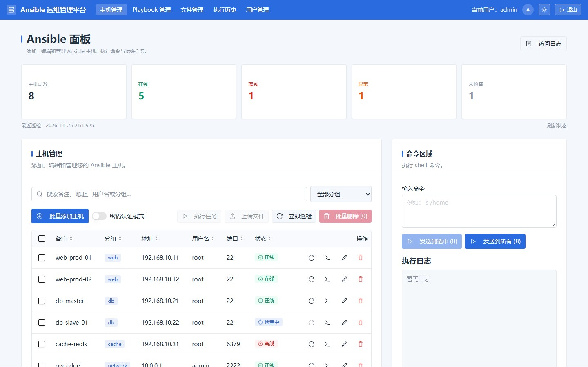
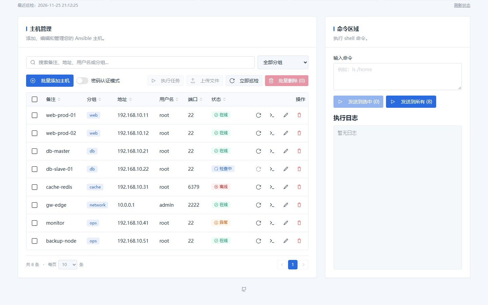
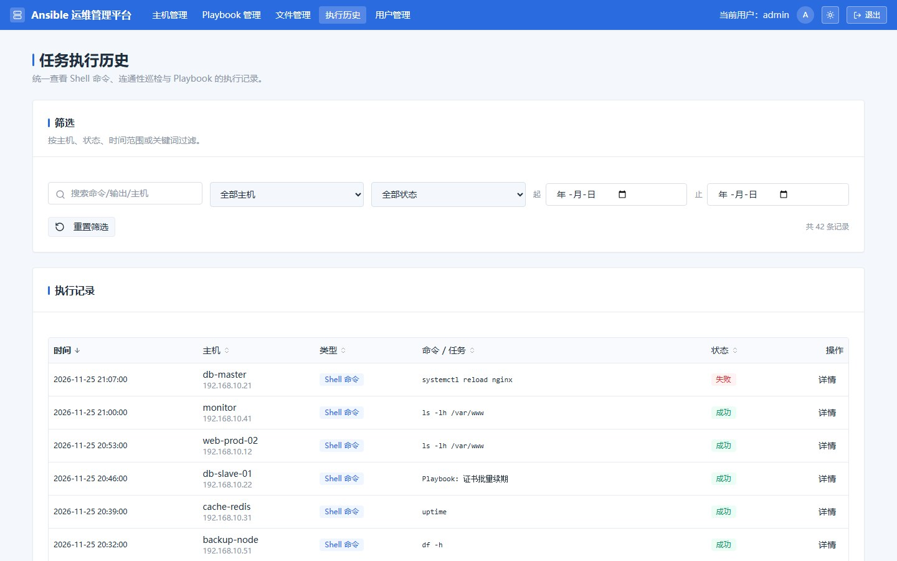
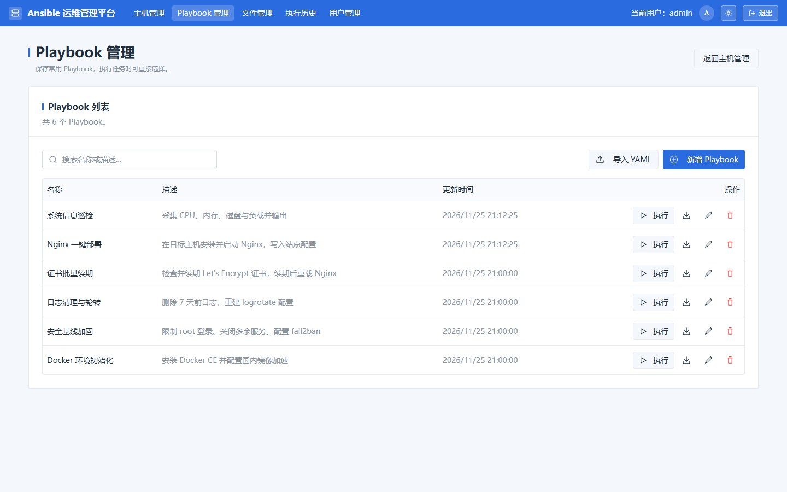
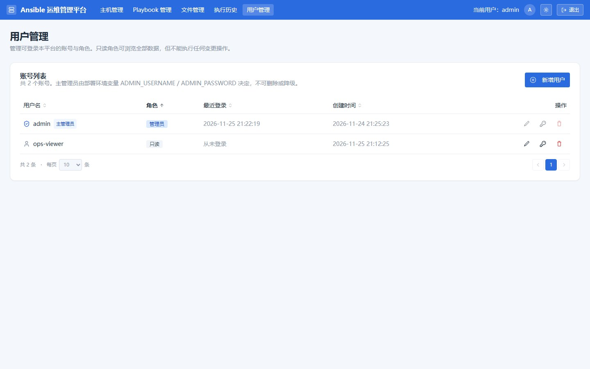
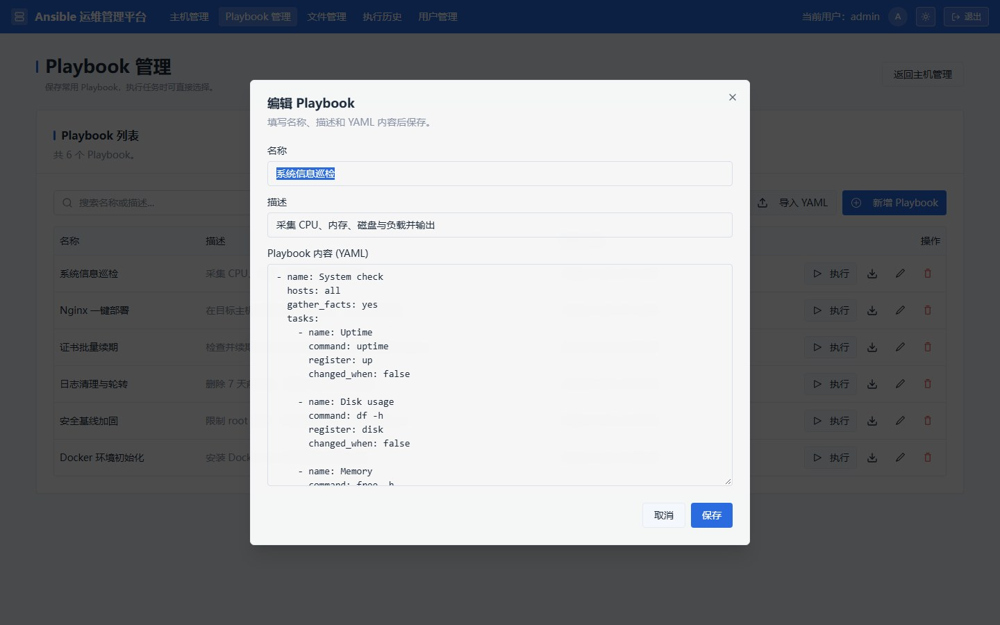
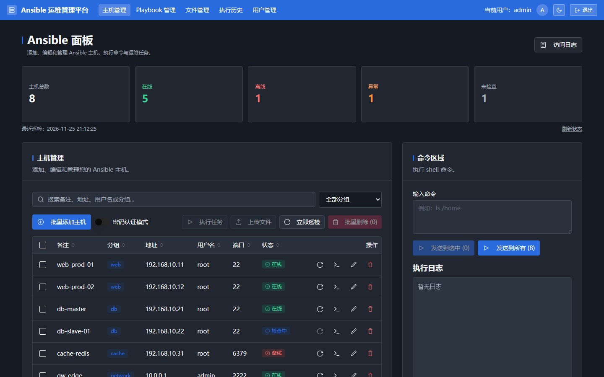
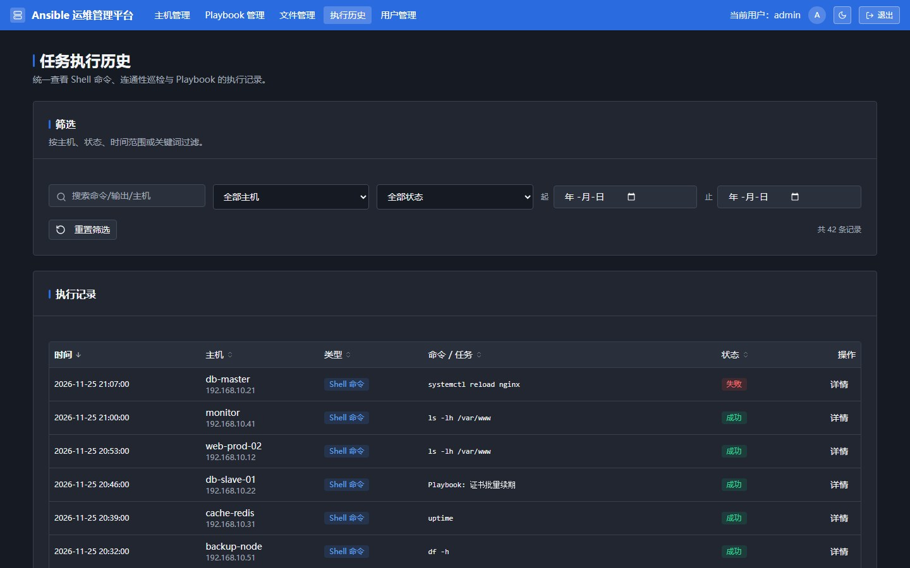

# Ansible Web 管理面板

轻量级 Ansible Web 面板：批量主机管理、命令执行、文件传输、Playbook 编排、Web 终端，一个容器跑起来。

基于 [sky22333/ansible-ui](https://github.com/sky22333/ansible-ui) 二次开发，增加了多用户 RBAC、暗色模式、表格排序分页、内置 HTTPS 与离线部署能力。

<p align="center">
  
</p>

## 功能特性

**主机管理**

- 批量添加、编辑、删除主机，支持密码认证与统一密钥认证
- 主机密码使用管理员凭证派生的密钥加密存储（PBKDF2 + AES-GCM），不落明文
- 一键连通性检测，采集主机 facts
- 后台定时巡检，自动刷新在线状态

**批量运维**

- 向多台主机并发下发命令，逐个回显执行结果
- Playbook 在线编写、保存、执行
- SFTP 文件管理：浏览、上传、下载、重命名、删除、新建目录、在线编辑保存
- Web 终端：xterm.js 直连 SSH，窗口自适应、链接可点

**权限与审计**

- 两种角色：`admin` 全部权限 / `viewer` 只读（写操作后端直接 403）
- 用户管理页增删账号、调整角色，权限变更对已登录会话立即生效
- 访问日志与命令执行日志，可按用户筛选、按时间清理

**界面**

- 浅色 / 深色 / 跟随系统三态切换，首屏无闪白
- 全部表格支持点击表头排序与分页（10 / 20 / 50 / 100）

## 界面预览



*主机管理：状态统计、批量操作，表头可点击排序*



*主机表底部：分页与每页条数切换*



*执行历史：按主机 / 状态 / 时间过滤，成功与失败一眼区分*



*Playbook 列表：执行、导出、编辑*



*用户管理：admin / viewer 双角色，主管理员不可降级*



*Playbook 在线编辑*



*暗色模式下的主机管理*



*暗色模式下的执行历史*

## 部署

### 前置条件

- Linux 主机（amd64 / arm64）
- Docker 20.10+ 与 Docker Compose v2（`docker compose version` 有输出即可）
- Docker 内需要能跑 `ansible`，容器已内置 openssh-client 与 sshpass

### 快速开始

`deploy/` 是一个自包含的发布包——前端产物、Dockerfile、部署脚本全在里面，可以单独拷到服务器构建，不需要 Node.js。
后端源码不在这里重复存放，`up` / `build` / `export` 执行前会自动从仓库根的 `src/ansible_ui` 同步到 `deploy/src`。

```bash
cd deploy
cp .env.example .env
vi .env                # 必须改 ADMIN_PASSWORD
./deploy.sh up
```

访问 `http://<服务器IP>:5000`，用 `.env` 里的账号登录。

首次启动会用 `ADMIN_USERNAME` / `ADMIN_PASSWORD` 初始化主管理员。主管理员不能在界面上删除或降级，凭证以 `.env` 为唯一来源。

### 开启 HTTPS

不需要 Nginx 或 Caddy，Flask 自己装载证书，除基础镜像外不额外拉取任何镜像。

```bash
./deploy.sh cert 192.168.1.10      # 换成服务器 IP 或域名，可一次给多个
./deploy.sh up
```

脚本会生成 10 年期自签证书（SAN 自动包含 `localhost`、`127.0.0.1`、本机检测到的 IP 以及你传入的名称），随后自动改写 `.env` 中的证书路径、把对外端口切到 443。

浏览器首次访问会提示证书不受信任，选择"继续访问"即可；Web 终端走 `wss://`，不受该提示影响。

换正式证书（Let's Encrypt 等）不必重新构建，把文件放进去重启即可：

```bash
scp fullchain.pem root@host:/path/deploy/certs/server.crt
scp privkey.pem   root@host:/path/deploy/certs/server.key
./deploy.sh restart
```

想退回明文：`./deploy.sh http`（清空证书配置、端口改回 5000，证书文件保留）。

### 离线部署

目标机器不通网时，先在有网机器上导出离线包：

```bash
cd deploy
./deploy.sh export            # → ansible-ui-offline-YYYYMMDD.tar.gz
```

包里包含 `image.tar`（完整镜像）、`docker-compose.yml`、`.env.example`、`deploy.sh`，开启 HTTPS 时还会带上 `certs/`。**不包含 `.env`**——管理员密码不会跟着包走。

拷到目标机器后：

```bash
tar xzf ansible-ui-offline-20261125.tar.gz
cd ansible-ui-offline-20261125
cp .env.example .env && vi .env      # 只需改密码，端口与证书路径已按导出机器填好
./deploy.sh load
```

`load` 会 `docker load` 载入镜像后直接启动，不构建、不需要网络，也不需要 Python 或源码。

升级版本：导入新包后执行 `docker compose up -d --force-recreate`。

### 使用预构建镜像

仓库自带 GitHub Actions 工作流（`.github/workflows/docker-publish.yml`），在 Actions 页面手动触发即可构建多架构镜像并推送到 `ghcr.io/liwl/ansible-ui`。

```bash
docker run -d --name ansible-ui \
  -p 5000:5000 \
  -e ADMIN_USERNAME=admin \
  -e ADMIN_PASSWORD='换成你的强密码' \
  -v ./data/db:/app/db \
  -v ./data/logs:/app/logs \
  -v ./data/files:/app/data \
  -v /root/.ssh:/root/.ssh:ro \
  ghcr.io/liwl/ansible-ui:latest
```

### 反向代理部署

面板可以裸跑在 5000 端口，也可以挂在 Nginx 后面统一收口（复用 443、做域名、接公司网关）。挂反代时有两件事必须做对。

**一、打开 `TRUST_PROXY`**

设了反代之后，Flask 看到的 `remote_addr` 永远是 Nginx 的地址（同一台机器就是 `127.0.0.1`），真实客户端 IP 只能从请求头里拿。但请求头客户端自己也能写，所以默认**不采信**：

| 配置 | 后果 |
| --- | --- |
| `TRUST_PROXY=false`（默认） | 审计日志里所有登录都来自 `172.x.x.x`；登录限流按"同一 IP + 用户名"计数，一个人的失败会把该用户名下所有人都锁住 |
| `TRUST_PROXY=true` + 正确的 Nginx 配置 | 拿到真实 IP，日志和限流都正常 |
| `TRUST_PROXY=true` 但 5000 端口对外开放 | 任何人都能伪造 `X-Real-IP` 绕过登录限流，**这是最危险的组合** |

所以打开它的前提是：5000 端口只在回环/内网可达，外部只能经 Nginx 进来。

```bash
# deploy/.env
TRUST_PROXY=true
```

容器内还需让 Flask 感知到原始协议是 HTTPS，否则 `request.is_secure` 为假，会话 Cookie 不会带 `Secure`、HSTS 也不下发。Nginx 传 `X-Forwarded-Proto` 后，面板会自动采信。

**二、Nginx 配置**

```nginx
server {
    listen 443 ssl http2;
    server_name ansible.example.com;

    ssl_certificate     /etc/nginx/certs/fullchain.pem;
    ssl_certificate_key /etc/nginx/certs/privkey.pem;

    client_max_body_size 512m;        # 与 MAX_UPLOAD_MB 保持一致，否则上传大文件会先被 Nginx 挡掉

    location / {
        proxy_pass http://127.0.0.1:5000;
        proxy_http_version 1.1;

        # 真实 IP：X-Real-IP 是覆盖写入，客户端伪造的值会被丢弃
        proxy_set_header Host              $host;
        proxy_set_header X-Real-IP         $remote_addr;
        proxy_set_header X-Forwarded-For   $proxy_add_x_forwarded_for;
        proxy_set_header X-Forwarded-Proto $scheme;

        # WebSocket（/ws/exec 实时终端、/ws/... 任务输出）必须放行 Upgrade
        proxy_set_header Upgrade    $http_upgrade;
        proxy_set_header Connection $connection_upgrade;

        # 终端是长连接，默认 60s 会在空闲时被掐断
        proxy_read_timeout  3600s;
        proxy_send_timeout  3600s;
        proxy_buffering     off;      # 命令输出要实时透传，缓冲会攒着不发
    }
}

server {
    listen 80;
    server_name ansible.example.com;
    return 301 https://$host$request_uri;
}
```

`$connection_upgrade` 需要先在 `http` 块里定义（Nginx 1.25 以下没有内置）：

```nginx
map $http_upgrade $connection_upgrade {
    default upgrade;
    ''      close;
}
```

**关于 `X-Forwarded-For` 的一个坑**：`$proxy_add_x_forwarded_for` 的语义是"把 `$remote_addr` **追加**到已有的 XFF 后面"，而"已有"那部分正是客户端自己发来的。所以一条伪造请求到后端长这样：

```
X-Forwarded-For: 1.2.3.4        ← 客户端塞的假 IP
X-Forwarded-For: 1.2.3.4, 203.0.113.7   ← Nginx 追加真实 IP 后
```

面板取的是**最后一跳**（`203.0.113.7`），不是最左边的 `1.2.3.4`；同时优先用 `X-Real-IP`——它由 `$remote_addr` 直接覆盖写入，没有追加语义，天生防伪造。

如果 Nginx 前面还有一层（CDN、云负载均衡），把那里也配成覆盖写入 `X-Real-IP`，或者用 `real_ip_header` 模块让 Nginx 自己解析可信链路，面板不用改。

**容器网络说明**：默认端口发布到 `0.0.0.0`，也就是绕过反代也能直连。Nginx 跑在宿主机上时，把它收回到回环：

```bash
# deploy/.env
HOST_BIND=127.0.0.1
```

改完 `./deploy.sh restart` 生效，此后 `ss -lntp | grep 5000` 应该只看到 `127.0.0.1:5000`。

若 Nginx 本身也是容器，把两者放进同一自定义网络，`proxy_pass` 指向 `http://ansible-ui:5000`，同时 `HOST_BIND=127.0.0.1` 或不发布端口都可以。

## 部署脚本

`deploy/deploy.sh` 的子命令：

| 命令 | 作用 |
| --- | --- |
| `up` | 构建镜像并启动（端口、协议由 `.env` 决定） |
| `cert [名称…]` | 生成自签证书并自动开启 HTTPS |
| `http` | 关闭 HTTPS，回到明文 |
| `export [文件名]` | 导出自包含离线部署包 |
| `load [包路径]` | 在离线机器上载入镜像并启动 |
| `build` | 只构建镜像，不启动 |
| `down` | 停止并移除容器（保留数据卷与证书） |
| `restart` | 重启容器（换证书后用这个） |
| `logs` | 实时查看日志 |
| `status` | 查看容器状态与访问地址 |
| `config` | 检查 compose 配置 |
| `sync` | 把 `src/ansible_ui` 同步到 `deploy/src`（构建前自动执行，一般不用手动调） |
| `frontend` | 开发用：本地构建前端并同步到 `deploy/dist` |

## 配置项

改 `deploy/.env`，完整说明见 `deploy/.env.example` 里的注释。

**部署**

| 变量 | 默认 | 说明 |
| --- | --- | --- |
| `HOST_PORT` | `5000` | 宿主机映射端口。开 HTTPS 时会被设为 `443` |
| `HOST_BIND` | `0.0.0.0` | 监听地址。套反代时设为 `127.0.0.1`，避免绕过反代直连 |
| `PORT` | `5000` | 容器内 Flask 监听端口，一般不用改 |
| `SSL_CERT_FILE` / `SSL_KEY_FILE` | 空 | 证书在**容器内**的路径，留空即明文 HTTP |

**账号与安全**

| 变量 | 默认 | 说明 |
| --- | --- | --- |
| `ADMIN_USERNAME` | `admin` | 主管理员用户名 |
| `ADMIN_PASSWORD` | `change-me-please` | 主管理员密码，**必须修改**（至少 8 位） |
| `SECRET_KEY` | 空 | JWT 签名密钥。留空时自动生成并保存到 `data/.secret_key`，重启后复用 |
| `JWT_EXPIRATION_HOURS` | `5` | 登录令牌有效期（小时） |
| `LOGIN_MAX_FAILURES` | `8` | 同一 IP + 用户名连续登录失败几次后锁定 |
| `LOGIN_LOCK_SECONDS` | `900` | 锁定时长（秒），到期自动解锁 |
| `MAX_UPLOAD_MB` | `512` | 单个请求体上限（MB），防止一个请求写满磁盘 |
| `TRUST_PROXY` | `false` | 前面套了反向代理时才改为 `true`，否则 X-Forwarded-For 可被伪造 |
| `ENABLE_HSTS` | `false` | 确认全链路 HTTPS 后打开，会下发 HSTS 头 |

**数据与日志**

| 变量 | 默认 | 说明 |
| --- | --- | --- |
| `DB_PATH` | `db/ansible.db` | SQLite 路径，已由数据卷持久化 |
| `LOG_FILE` | `logs/app.log` | 应用日志 |
| `LOG_LEVEL` | `INFO` | 日志级别 |

**Ansible 与巡检**

| 变量 | 默认 | 说明 |
| --- | --- | --- |
| `ANSIBLE_HOST_KEY_CHECKING` | `False` | 是否校验被控端 SSH 指纹 |
| `SSH_PRIVATE_KEY` | `/root/.ssh/id_ed25519` | 统一密钥认证使用的私钥 |
| `PING_ENABLED` | `true` | 是否启用后台定时巡检 |
| `PING_INTERVAL` | `300` | 巡检间隔（秒），最小 30 |

**构建期**（仅 `docker build` 时生效，国内建议保持镜像源）

| 变量 | 默认 | 说明 |
| --- | --- | --- |
| `PIP_INDEX_URL` | 清华源 | pip 源 |
| `DEBIAN_MIRROR` | 阿里云 | Debian apt 源 |

## SSH 密钥认证

默认读取容器内的 `/root/.ssh/id_ed25519`。把宿主机密钥目录挂进容器即可（compose 里有一行注释掉的挂载，取消注释即可启用）。

```bash
ssh-keygen -t ed25519                     # 一路回车
ssh-copy-id -i ~/.ssh/id_ed25519.pub root@192.168.2.1
```

如果目标机 SSH 不是 22 端口，加 `-o Port=2222`。

启用统一密钥认证后，添加主机时不需要再填密码。

## 本地开发

后端（Python 3.10，`ansible-core 2.13` 不支持 3.11+）：

```bash
pip install -r requirements.txt
pip install -e .          # 让 src/ansible_ui 可导入
ADMIN_USERNAME=admin ADMIN_PASSWORD=dev-password python -m ansible_ui
```

不想安装也可以临时指定源码路径：

```bash
PYTHONPATH=src ADMIN_USERNAME=admin ADMIN_PASSWORD=dev-password python -m ansible_ui
```

前端（Vite 已配置代理到 `localhost:5000`，含 WebSocket）：

```bash
cd web
npm install
npm run dev
```

改完前端后重新构建并同步到发布包（后端源码不需要同步，构建时自动取 `src/`）：

```bash
./deploy.sh frontend    # web/dist → deploy/dist
```

跑一遍接口回归测试（零依赖，只用标准库）：

```bash
python -m unittest discover tests
```

## 目录结构

```
.
├── src/ansible_ui/            # 后端包（唯一一份源码）
│   ├── __init__.py            # 包入口：注册钩子、错误处理器、蓝图
│   ├── __main__.py            # 进程入口：日志、初始化、TLS、app.run
│   ├── config.py              # 全部环境变量集中读取（唯一来源）
│   ├── extensions.py          # Flask app 与 db/ansible/crypto 单例
│   ├── security.py            # 鉴权装饰器、JWT、限流、客户端 IP
│   ├── middleware.py          # 请求钩子：只读拦截、安全头、访问日志
│   ├── errors.py              # 统一错误处理（413/404/500）
│   ├── utils.py               # 通用小工具
│   ├── api/                   # 按业务拆分的蓝图，一个模块一组接口
│   │   ├── auth.py            #   登录、当前用户
│   │   ├── hosts.py           #   主机 CRUD、facts、连通性、手动巡检
│   │   ├── execute.py         #   命令下发
│   │   ├── files.py           #   SFTP 浏览编辑、批量上传
│   │   ├── terminal.py        #   Web 终端（WebSocket）
│   │   ├── logs.py            #   执行日志、访问审计
│   │   ├── users.py           #   用户管理
│   │   ├── playbooks.py       #   Playbook 保存与执行
│   │   └── frontend.py        #   SPA 静态资源托管
│   └── services/              # 领域服务层（不依赖请求上下文）
│       ├── database.py        #   SQLite 访问层
│       ├── ansible_manager.py #   ansible / paramiko 封装
│       ├── crypto_utils.py    #   主机密码加解密（PBKDF2 + AES-GCM）
│       ├── ssh.py             #   SSH / SFTP 连接管理
│       └── patrol.py          #   主机巡检与定时调度
├── web/                       # React 18 + TS + Vite + Tailwind + shadcn/ui
├── tests/                     # 路由表回归测试（零依赖）
├── scripts/                   # WSL 环境辅助脚本（与业务无关）
├── pyproject.toml             # 项目元数据、ruff、pytest 配置
├── requirements.txt           # 依赖唯一来源
└── deploy/                    # 自包含发布包
    ├── dist/                  #   前端构建产物（入库）
    ├── src/                   #   构建时由 deploy.sh 从 src/ 复制（不入库）
    ├── Dockerfile             #   唯一构建入口
    ├── docker-compose.yml
    ├── deploy.sh              #   部署脚本
    └── .env.example           #   配置模板
```

后端代码只有 `src/ansible_ui` 一份。`deploy/src` 是构建前由 `./deploy.sh sync` 生成的临时副本（已 gitignore），
这样既保证 `deploy/` 能单独拷到服务器构建，又不会出现副本与源码不一致的问题。

## 注意事项

- **安全声明**：任何系统都无法保证没有 BUG。暴露到公网时，建议前面再套一层带 IP 白名单的反向代理，并使用强密码。
- **内置防护**：登录失败限流（默认 8 次 / 锁 15 分钟）、请求体大小上限、CSP 与一整套安全响应头、SFTP 异常不外泄内部细节、登录令牌不接受 URL 传参（仅 WebSocket 例外）。
- **套反代要设 `TRUST_PROXY=true`**：否则日志里记录的全是反代 IP，登录限流也会把所有人生成同一个键。反过来，直接对外时**不要**打开它，否则谁都能伪造来源 IP。
- **改密码的代价**：主机密码用管理员凭证派生的密钥加密。修改 `ADMIN_PASSWORD` 后，此前保存的主机密码将无法解密，需要重新录入。
- **主管理员唯一来源**：主管理员凭证以 `.env` 为准，界面上无法删除或降级。
- **`viewer` 角色是只读的**：可以浏览主机、历史、文件与 Playbook，但所有写操作（含终端）会被后端拒绝。
- **`.env` 别进版本库**：里面是管理员密码，`.gitignore` 已排除。
- **端口冲突**：`443` 被占用时（装了宝塔、Nginx 等），改 `HOST_PORT` 为其他值再启动。

## 许可证

[GPL-3.0](./LICENSE)，版权归原作者 [sky22333](https://github.com/sky22333) 所有。

## Star History

[](https://star-history.dera.page/#sky22333/ansible-ui&type=date&legend=top-left)
